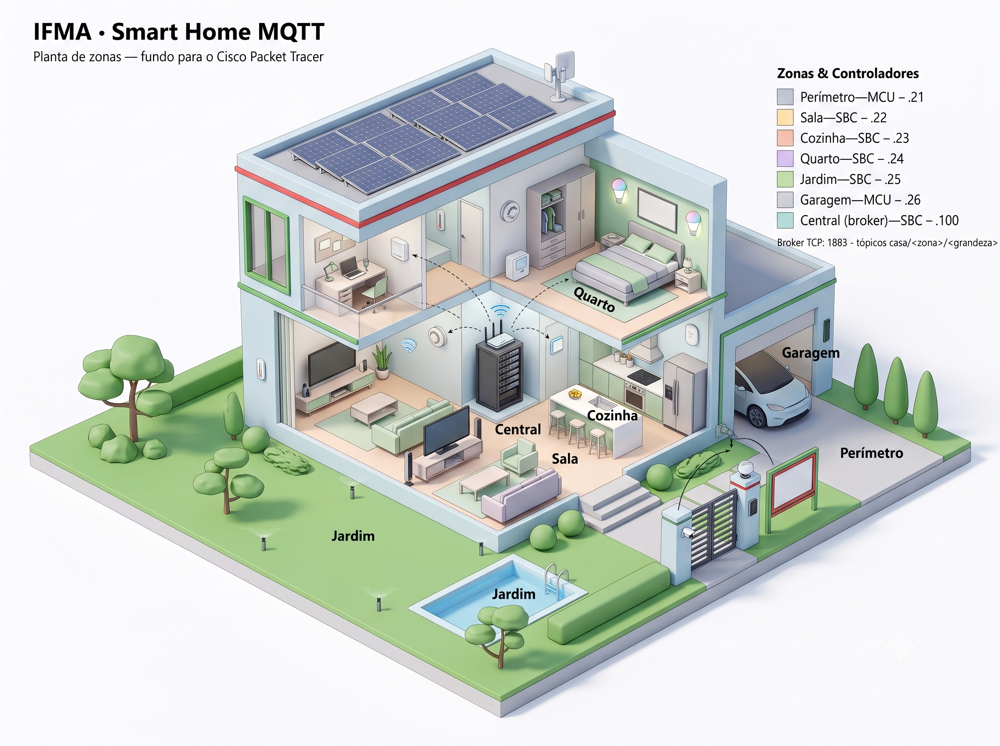

# Projeto IFMA V4 — Automação Residencial com MQTT no Cisco Packet Tracer

Evolução do [projeto V3](https://github.com/ccfernandes600/ifma-smart-home-packet-tracer) para uma arquitetura **distribuída com protocolo MQTT**, múltiplas zonas de monitoramento e maior número de dispositivos IoT.



---

## Status do Projeto

**Fase atual:** Código fechado — o que falta depende da bancada no simulador

- [x] Clonagem e análise do projeto V3 (referência)
- [x] Pesquisa de dispositivos IoT compatíveis com SBC-PT + Python
- [x] Documentação da Python API do Packet Tracer
- [x] Definição final das zonas e dispositivos (6 zonas + central)
- [x] Definição da arquitetura MQTT (Opção B: pub/sub sobre TCP+JSON)
- [x] Mapa de portas e endereçamento IP ([ARQUITETURA.md](docs/ARQUITETURA.md))
- [x] Confirmar suporte a `tcp` na MCU-PT — **confirmado** (02/07/2026): a Garagem conectou ao broker
- [x] Desenvolvimento dos scripts Python (SBCs + MCU) — 8 scripts em `src/`:
      broker central, 6 zonas e o publicador do RFID Reader
- [ ] Validar no simulador as 3 zonas que nunca rodaram: cozinha, quarto e jardim
- [ ] Montagem da topologia no Packet Tracer
- [x] **Painel web servido pela própria Central** (`HTTPServer` :80) — rota `/` com tabela por zona
      e `/estado` com JSON bruto; prévia fora do simulador em `verificacao/previa_painel.py`
- [x] **Modo viagem fechado:** Sala, Quarto, Perímetro e Garagem reagem; Cozinha e Jardim ignoram
      por decisão registrada
- [ ] Abrir o painel no PC0 com as seis zonas publicando — é o teste que fecha o projeto
- [ ] Montagem da topologia no Packet Tracer
- [ ] Documentação final

---

## Comparativo V3 → V4

| Aspecto | V3 (original) | V4 (MQTT) |
|---------|---------------|-----------|
| Protocolo IoT | GPIO direto (local) | MQTT pub/sub (distribuído) |
| Controladores | 1 SBC | 5+ SBCs (1 central + zonas) |
| Sensores | 4 | 16+ |
| Atuadores | 6 | 20+ |
| Portas GPIO | 10 (D0–D9) | 50+ (10 por SBC) |
| Estados segurança | 3 globais | 5 globais + 4–5 por zona |
| Comunicação entre dispositivos | Inexistente | TCP/MQTT entre SBCs |
| Protocolos de rede | HTTP, DNS, NAT, Frame Relay | + MQTT, DHCP, NTP, Syslog, Email |
| Dashboard | Estático | Dados em tempo real por zona |

---

## Notas Técnicas — Limitações do Simulador

Durante a montagem no Packet Tracer 9.0.0, encontramos comportamentos do simulador que não estavam documentados de forma clara e que mudaram decisões de arquitetura. Registramos aqui o porquê de cada uma, para quem for reproduzir o projeto não perder tempo com os mesmos impasses.

### CO Detector e CO₂ Detector aparecem na topologia, mas ficam decorativos

**Descoberta:** ao testar `digitalRead()`/`analogRead()` nesses sensores, o valor sempre voltava `0`, mesmo com um Old Car ligado bem ao lado.

**Causa:** esses dois dispositivos não são componentes GPIO como Motion Sensor ou Smoke Detector. A própria documentação do dispositivo, dentro do Packet Tracer, diz:

```
Carbon Monoxide Detector
Features: Registration Server Compatible
Direct Control: N/A   Local Control: N/A   Remote Control: N/A
```

`N/A` nos três tipos de controle significa que o dispositivo **não tem nenhuma API programável** — ele só se conecta (via WiFi ou cabo) a um *Registration Server*/Home Gateway para aparecer num painel visual. Um script Python em outro dispositivo não tem como ler o estado dele.

**Solução:** a leitura real do nível de gás usa o pacote `environment`, que lê a concentração **ambiente simulada** diretamente — sem depender do dispositivo sensor:

```python
from environment import *
nivel_co = Environment.get("CO")    # retorna % (float), ex.: 0.06
```

Confirmado empiricamente: `Environment.get("CO")` e `Environment.get("CO2")` funcionam e retornam valores condizentes com um Old Car ligado nas proximidades (documentação oficial: ~1%/hora de CO, ~2%/hora de CO₂). Usamos o mesmo limiar do dispositivo oficial (**20%**) para disparar o alarme na lógica.

**Decisão de projeto:** mantivemos o CO Detector e o CO₂ Detector na topologia (com IP próprio — ver [ARQUITETURA.md](docs/ARQUITETURA.md)) por completude visual, já que fisicamente eles existiriam numa garagem real. Mas eles ficam **decorativos**: sem servidor de registro configurado, não influenciam a automação. Quem detecta o gás de verdade é o código, via `environment`.

### Smart Things podem virar nós MQTT — o caso do RFID Reader

**Descoberta:** o RFID Reader também não tem API GPIO (`Direct/Local/Remote Control: N/A`), e diferente do gás não havia workaround via `environment` — chegamos a descartá-lo do projeto.

**Reviravolta:** todo Smart Thing do PT tem um **script Python próprio, editável** (aba Programming do dispositivo), e testamos que esse motor de script **tem acesso a `tcp` e `json`**. Em vez de outro nó tentar ler o Reader (impossível), **o próprio Reader publica no broker**: substituímos o script padrão (que falava com um Registration Server) por um cliente do nosso protocolo, que detecta o cartão por proximidade física e publica `casa/perimetro/rfid` — ver [src/thing_rfid_reader.py](src/thing_rfid_reader.py).

**Armadilhas encontradas no caminho** (o motor de script dos Things é diferente do SBC/MCU):
- O device vem de fábrica com **0 slots de I/O** — é preciso ir em `Advanced → I/O Config` e mudar `Digital Slots` para 1;
- Os exemplos da Cisco são Python 2 (`xrange`, `delay`/`idle`);
- `devicesAt()` retorna um **dicionário** `{'0': 'Nome', ...}`, não uma lista — indexar como `devices[0]` quebra com `KeyError`.

**Lição:** `Control: N/A` significa que o dispositivo não é controlável *de fora* — mas o script *interno* é programável e tem rede. Qualquer Smart Thing pode virar um nó publish/subscribe.

### MCU tem só 6 portas usáveis, e o "bug analógico" é só em 4 delas

**Causa:** a MCU-PT (equivalente a um Arduino) tem 6 portas digitais flexíveis (D0–D5, aceitam `digital`/`analog`/`custom`) e mais 4 portas analógicas dedicadas (A0–A3). O bug histórico do projeto V3 (que consumiu ~40% do tempo de desenvolvimento) está **só nas A0–A3** — as D0–D5 funcionam normalmente, inclusive com `analogRead`/`analogWrite`.

**Solução:** todo o V4 usa exclusivamente D0–D5 na MCU. O gargalo real da MCU não é o tipo de sinal, é o **número de portas** (6) — por isso zonas com mais de 6 dispositivos viraram SBC (que tem 10 portas D0–D9, todas flexíveis).

### `analogWrite()` aceita 0–1023, mas a resolução real é 256 níveis

A faixa de entrada é 0–1023, mas o hardware simulado só tem 256 níveis de PWM (8 bits): `1023` equivale ao nível máximo (255), `0` ao mínimo, proporcional no meio. Usamos a faixa 0–1023 no código (compatível com o V3), sabendo que a granularidade efetiva é menor.

### Por que TCP+JSON em vez de MQTT "puro"

O Packet Tracer **não tem** um pacote Python `mqtt` nativo — o "MQTT" que existe é um app de Desktop separado, sem acesso ao GPIO. Como não dá para publicar MQTT de dentro do mesmo script que lê os sensores, implementamos o padrão publish/subscribe sobre `tcp`+`json` (nativos), na porta oficial do MQTT (1883). Ver detalhes em [ARQUITETURA.md](docs/ARQUITETURA.md).

---

## Estrutura do Repositório

```
ifma-smart-home-mqtt/
├── README.md                                    # Este arquivo
├── LICENSE                                      # Licença MIT
├── .gitignore                                   # Filtros de arquivos
├── assets/
│   └── planta_casa_zonas.png                    # Planta isométrica de zonas (capa + fundo do PT)
├── docs/
│   ├── LEVANTAMENTO_DISPOSITIVOS_PT9.md         # Catálogo de sensores/atuadores/API
│   ├── ARQUITETURA.md                           # Broker, mapa de portas, IPs, protocolo
│   ├── EVOLUCAO_HARDWARE_REAL.md                # Roadmap: migração para dispositivos físicos
│   ├── MONTAGEM_PACKET_TRACER.md                # Guia passo a passo de montagem no PT
│   └── RETOMAR.md                               # Revisão de 20-21/09: o que está fechado e o que falta
├── src/
│   ├── broker_central.py                        # Central/broker (TCPServer :1883) — validado no PT
│   ├── zona_garagem.py                          # Zona MCU (template digital) — validado no PT
│   ├── zona_perimetro.py                        # Zona MCU (segurança + RFID) — validado no PT
│   ├── zona_sala.py                             # Zona SBC (clima) — validado no PT
│   ├── zona_cozinha.py                          # Zona SBC (incêndio/gás) — escrito, a testar
│   ├── zona_quarto.py                           # Zona SBC (descanso/ar) — escrito, a testar
│   ├── zona_jardim.py                           # Zona SBC (meteo/irrigação) — escrito, a testar
│   ├── thing_rfid_reader.py                     # Script embutido do RFID Reader (nó MQTT) — validado no PT
│   └── thing_heating_element_teste.py           # Script embutido do Heating Element (instrumento de teste)
├── verificacao/
│   ├── verificar.py                             # Contrato executável: restrições, portas, tópicos
│   └── previa_painel.py                         # Renderiza o painel da Central fora do simulador
└── web/                                         # Vazia: o painel é gerado pela Central, não servido daqui
```

---

## Documentação de Referência

- [Arquitetura](docs/ARQUITETURA.md) — broker, mapa de portas dos 7 nós, endereçamento IP e protocolo de mensagens
- [Levantamento de Dispositivos IoT](docs/LEVANTAMENTO_DISPOSITIVOS_PT9.md) — catálogo completo de sensores, atuadores e Python API do PT 9.0.0
- [Evolução para Hardware Real](docs/EVOLUCAO_HARDWARE_REAL.md) — roadmap de migração do simulador para dispositivos físicos (Raspberry Pi + ESP32 + Mosquitto)
- [Projeto V3 (original)](https://github.com/ccfernandes600/ifma-smart-home-packet-tracer) — referência de arquitetura e código

---

## Tecnologias

- **Cisco Packet Tracer 9.0.0** — simulador de redes e IoT
- **Python 3** (MicroPython no SBC-PT) — lógica de automação
- **MQTT** — protocolo de mensagens IoT (publish/subscribe)
- **TCP/UDP** — comunicação entre SBCs
- **NAT / Frame Relay / DHCP / NTP / Syslog** — infraestrutura de rede
- **HTML/CSS/JS** — dashboard web

---

## Licença

Licença **MIT**. Consulte o arquivo [LICENSE](LICENSE).

---

> Projeto desenvolvido como atividade prática de Redes de Computadores e IoT — **IFMA Campus Monte Castelo**.
