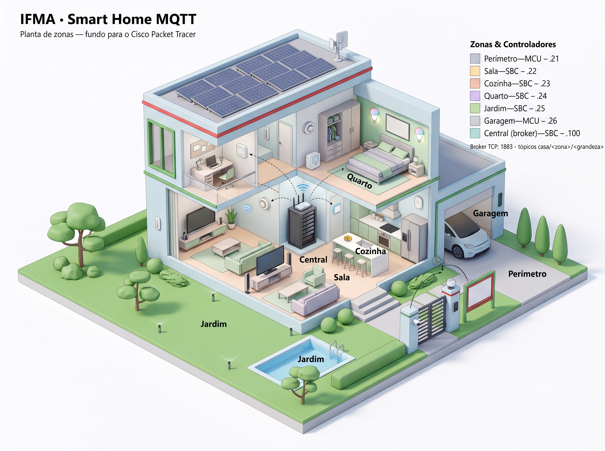

# Arquitetura do Projeto V4 — Smart Home MQTT

**Base:** evolução do V3 (GPIO local, 1 SBC) para uma rede **distribuída** de 7 nós com padrão **publish/subscribe**.
**Decisão de arquitetura:** Opção **B** (pub/sub sobre TCP+JSON), evoluindo para **C** (broker MQTT real no IoT Server como vitrine). Ver seção 3 do [LEVANTAMENTO_DISPOSITIVOS_PT9.md](LEVANTAMENTO_DISPOSITIVOS_PT9.md).



---

## 1. Por que TCP+JSON e não MQTT nativo

O PT **não tem pacote Python `mqtt`**. Logo é impossível publicar MQTT de dentro do mesmo script que lê o GPIO. Como `tcp` e `json` são nativos, cada nó roda **um único script** que lê sensores E fala na rede. Reproduzimos o padrão MQTT (broker, topics, pub/sub) sobre TCP, usando a **porta oficial 1883** pela autenticidade.

---

## 2. Topologia lógica (hub em estrela)

```
        ┌──────────────── Central SBC (broker) ────────────────┐
        │  192.168.1.100  ·  TCPServer.listen(1883)            │
        │  • mantém o estado global de todas as zonas          │
        │  • aplica regras entre zonas (cross-zone)            │
        │  • alimenta o dashboard e o LCD mestre               │
        └───▲────▲────▲────▲────▲────▲──────────────────────────┘
            │    │    │    │    │    │   ← TCPClient.connect(192.168.1.100, 1883)
         Perím Sala Cozi Quar Jard  Garagem
        (MCU) (SBC)(SBC)(SBC)(SBC)  (MCU)
          .21  .22  .23  .24  .25    .26
```

Cada zona roda a **lógica local rápida** (reação imediata aos seus próprios sensores, no espírito do `processar_sistema()` do V3). A **Central** cuida do que cruza zonas (ex.: gás na garagem → aviso no Home Speaker + LCD mestre) e do dashboard.

---

## 3. Endereçamento IP — LAN 192.168.1.0/24

| Nó | IP | Controlador | Papel |
|---|---|---|---|
| Router0 | 192.168.1.1 | — | Gateway |
| PC0 | 192.168.1.10 | — | Estação / dashboard |
| Central | 192.168.1.100 | SBC | Broker (TCPServer :1883) + lógica global |
| Perímetro | 192.168.1.21 | **MCU** | Cliente — `tcp` confirmado ✅ |
| Sala | 192.168.1.22 | SBC | Cliente |
| Cozinha | 192.168.1.23 | SBC | Cliente |
| Quarto | 192.168.1.24 | SBC | Cliente |
| Jardim | 192.168.1.25 | SBC | Cliente |
| Garagem | 192.168.1.26 | **MCU** | Cliente — `tcp` confirmado ✅ |
| CO Detector (Garagem) | 192.168.1.31 | Smart Thing | **Decorativo** — sem Registration Server, não participa da automação |
| CO₂ Detector (Garagem) | 192.168.1.32 | Smart Thing | **Decorativo** — sem Registration Server, não participa da automação |
| RFID Reader (Perímetro) | 192.168.1.33 | Smart Thing | **Nó ativo** — roda `thing_rfid_reader.py` (script embutido) e publica `casa/perimetro/rfid` direto no broker |

> Faixa `.31+` reservada para Smart Things (WiFi ou cabo). CO/CO₂ são decorativos — a leitura real de gás usa o pacote `environment` no `zona_garagem.py`. O **RFID Reader é caso especial**: não tem API GPIO (chegou a ser descartado), mas foi **reabilitado como nó publicador independente** — o script Python embutido do próprio Thing (aba Programming) tem acesso a `tcp`/`json` e publica as leituras de cartão direto no broker, sem ocupar porta de MCU nenhuma. Ver seção 5 e os gotchas no [LEVANTAMENTO_DISPOSITIVOS_PT9.md](LEVANTAMENTO_DISPOSITIVOS_PT9.md).

---

## 4. Protocolo de mensagens (JSON sobre TCP)

**Taxonomia de tópicos:** `casa/<zona>/<grandeza>` para dados; `casa/<zona>/cmd/<atuador>` para comandos direcionados; `casa/todas/cmd/<comando>` para broadcast (Central → todas as zonas conectadas).

**Publish (zona → Central), quando um sensor muda:**
```json
{"topic": "casa/garagem/co", "payload": 1, "ts": 12345}
```
- `payload`: digital = 0/1 · analógico = leitura crua 0–1023 · custom = string
- `ts`: uptime em segundos (`ctime`/uptime do nó)

**Command (Central → zona):**
```json
{"topic": "casa/garagem/cmd/fan", "payload": 1, "ts": 12346}
```

**Broadcast (Central → todas as zonas), ex.: mudança de modo:**
```json
{"topic": "casa/todas/cmd/modo", "payload": true}
```
Enviado a cada zona conectada quando o `modo_viagem` muda (botão na Central), e também individualmente para qualquer zona nova assim que ela conecta (para sincronizar o modo atual).

**Tópicos por zona (referência):**
- Perímetro: `movimento`, `campainha`, `rfid` (publicado pelo próprio RFID Reader, nó independente) · cmd: `porta`, `sirene`, `camera`
- Sala: `temp`, `umidade`, `luz`, `movimento` · cmd: `ac`, `fan`, `rgb`
- Cozinha: `fumaca`, `co`, `temp`, `umidade` · cmd: `sprinkler`, `janela`, `fan`, `alarme`
- Quarto: `temp`, `umidade`, `luz`, `movimento` · cmd: `ac`, `umidificador`, `led`, `janela`
- Jardim: `agua`, `vento`, `pressao`, `luz` · cmd: `irrigacao`, `dreno`, `luz`
- Garagem: `co`, `co2`, `movimento` · cmd: `porta`, `fan`, `alarme`

### Decisão: quem decide o quê — a zona, não a Central

**Fechado em 20/09/2026.** A zona é **autônoma**: lê os próprios sensores e aciona os próprios atuadores sem pedir licença. A Central só decide o que **atravessa zonas** ou depende de política da casa. Esse é o critério para saber onde uma regra nova deve morar.

**O que a Central decide hoje** — 7 dos 22 tópicos publicados chegam a alguma regra:

| Tópico | Regra na Central | Por que não é da zona |
|---|---|---|
| `casa/garagem/co`, `casa/garagem/co2`, `casa/cozinha/co`, `casa/cozinha/fumaca` | alerta de gás no LCD mestre + Home Speaker | o aviso é para a casa inteira, não para quem está na zona |
| `casa/garagem/movimento` | **intrusão**, só quando combinado com `modo_viagem` | o modo é estado da casa; a garagem sozinha não sabe se há alguém em casa |
| `casa/perimetro/campainha` | tela "VISITANTE" | idem — o aviso é central |
| `casa/perimetro/rfid` | whitelist `CARTOES_VALIDOS` → `cmd/porta` | é política de segurança: muda num lugar só, e o leitor continua "burro" |

**O que a zona decide sozinha:** fumaça na Cozinha aciona sprinkler, janela, fan e alarme no mesmo loop; a Garagem liga o exaustor no gás e o alarme no movimento em modo viagem; o Perímetro acende a câmera no movimento. Nada disso passa pela rede.

**A consequência que justifica a decisão:** zona sem broker **continua automatizando**. O `publicar()` das zonas, sem conexão, apenas loga o aviso e segue com a lógica local. Se as regras morassem na Central, uma zona desconectada ficaria cega — inclusive a Cozinha, que é a de risco de incêndio. Num simulador que roda em sala de aula, com a rede sendo mexida ao vivo, esse é o cenário provável, não o excepcional.

**Os `cmd/*` que ninguém aciona são funcionalidade, não código morto.** As zonas tratam **20 comandos de atuador**; a Central envia **um** (`casa/perimetro/cmd/porta`, no fluxo RFID) mais o broadcast `casa/todas/cmd/modo`. Os **19 restantes** são a interface de comando manual — o que o dashboard vai usar para ligar a irrigação, acender o RGB da Sala ou abrir a janela do Quarto. Esperam um remetente humano, não uma regra.

Pelo mesmo motivo, **15 tópicos publicados não têm consumidor nenhum** hoje (temperatura, umidade, luz, vento, pressão, água e o movimento das zonas que não a Garagem): são a matéria-prima do painel. Enquanto o dashboard não existir, dois terços do tráfego da casa não servem a ninguém — o que promove "onde servir o dashboard" de item futuro a **pendência que dá sentido ao protocolo** (ver §8).

> O verificador imprime "6 lidos, 16 só para o dashboard" porque enxerga apenas os `estado.get()` de `avaliar_regras()`. O 7º consumidor é o `casa/perimetro/rfid`, tratado como evento dentro de `ao_receber()`, antes de chegar ao estado.

**A alternativa descartada** era a Central concentrar as regras — mais fiel ao pub/sub. Além de tirar a autonomia das zonas, ela exigiria um mapa zona→IP no broker: o `enviar_comando()` localiza o destino comparando `remoteIP()` com um IP passado à mão, e hoje o único que a Central conhece é o `PERIMETRO_IP`. Quem quiser reabrir a discussão começa por aí.

### Regra: Perímetro — cartão RFID válido abre a Porta

O RFID Reader (nó independente) publica a tag lida em `casa/perimetro/rfid`. A **Central** valida contra a whitelist `CARTOES_VALIDOS` (em `broker_central.py`):
- **Cartão válido** → Central envia `casa/perimetro/cmd/porta = 1`, mostra "ACESSO LIBERADO" no LCD e **fecha a porta automaticamente** após `DURACAO_PORTA_RFID` segundos (timer via `uptime()`, mesmo padrão de hold das zonas).
- **Cartão inválido** → LCD mostra "CARTAO INVALIDO" com o ID (sem abrir nada).

A validação fica na Central (não no Reader) de propósito: a whitelist é política de segurança da casa — centralizá-la permite mudar cartões autorizados num lugar só, e o Reader continua "burro" (só reporta), como um leitor real.

### Regra: Garagem — alarme por movimento só em modo viagem

O Alarm da Garagem soa por **duas fontes** combinadas em `atualizar_alarme()`: gás perigoso (sempre) OU movimento detectado **enquanto `modo_viagem` está ativo** (ninguém esperado em casa). Em modo normal, movimento só aparece informativamente no LCD da Central ("MOVIMENTO — Garagem (normal)"), sem soar nenhum alarme — evita disparo falso toda vez que alguém entra na garagem no dia a dia. Ver `carro_ligado()`/`atualizar_alarme()` em `src/zona_garagem.py`.

---

## 5. Mapa de portas por nó

Regra: SBC = 10 portas D0–D9 flexíveis · MCU = 6 portas usáveis D0–D5, também flexíveis (aceitam analog/digital/custom); evitar as analógicas dedicadas A0–A3 (bug do V3). Gargalo da MCU = 6 dispositivos, não o analógico.

### Central — SBC (192.168.1.100) · 3/10
| Porta | Dispositivo | Diretiva |
|---|---|---|
| D0 | Push Button (modo casa/viagem) | `digitalRead` |
| D1 | LCD mestre | `customWrite` |
| D2 | Home Speaker | `digitalWrite` |

### Perímetro — MCU (192.168.1.21) · 4/6 (2 portas livres)
| Porta | Dispositivo | Diretiva |
|---|---|---|
| D0 | Motion Sensor | `digitalRead` |
| D1 | Push Button (campainha) | `digitalRead` |
| D2 | Door | `customWrite` |
| D3 | Siren | `customWrite` ✅ |
| D4 | Camera | `customWrite` ✅ |
| D5 | *(livre)* | — |

> **Gotcha (02/07/2026), em duas etapas:** RFID Reader não tem API GPIO — a doc do device declara `Direct/Local/Remote Control: N/A`, então `customRead()` por cabo IoT nunca funcionaria (chegou a ser descartado do projeto). **Reviravolta:** descobrimos que todo Smart Thing tem um **script Python próprio editável** (aba Programming/Advanced), e esse motor tem `tcp`/`json` — o Reader foi **reabilitado como nó publicador independente**: `src/thing_rfid_reader.py` roda dentro dele, detecta o RFID Card por proximidade física (`devicesAt()`/`getDeviceProperty`) e publica `casa/perimetro/rfid` direto no broker. Não ocupa porta de MCU. A Porta continua sendo acionada por comando (`cmd/porta`). Ver seção 1.1 do [LEVANTAMENTO_DISPOSITIVOS_PT9.md](LEVANTAMENTO_DISPOSITIVOS_PT9.md) e o passo a passo (inclusive o I/O Config) no [MONTAGEM_PACKET_TRACER.md](MONTAGEM_PACKET_TRACER.md).
>
> Cenário MQTT cross-zone: campainha (D1) → publica `casa/perimetro/campainha` → Central aciona o Home Speaker.
> ✅ Siren e Camera confirmados no PT (02/07/2026): `customWrite` com `"0"/"1"` (liga/desliga) funciona nos dois.

### Sala — SBC (192.168.1.22) · 9/10
| Porta | Dispositivo | Diretiva |
|---|---|---|
| D0 | Temperature | `analogRead` |
| D1 | Humidity | `analogRead` |
| D2 | Photo Sensor | `analogRead` |
| D3 | Motion Sensor | `digitalRead` |
| D4 | AC / Air Cooler | `digitalWrite` |
| D5 | Fan | `digitalWrite` |
| D6 | LED R | `analogWrite` |
| D7 | LED G | `analogWrite` |
| D8 | LED B | `analogWrite` |
| D9 | *(livre)* | — |

### Cozinha — SBC (192.168.1.23) · 4/10 (6 portas livres)
| Porta | Dispositivo | Diretiva |
|---|---|---|
| D0 | Temperature | `analogRead` |
| D1 | Humidity | `analogRead` |
| D2 | Fire Sprinkler | `digitalWrite` — não confirmado |
| D3 | Window | `customWrite` — não confirmado |
| D4 | Fan | `customWrite` (confirmado) |
| D5 | Alarm | `digitalWrite` (confirmado) |
| D6–D9 | *(livres)* | — |

> ✅ **Aplicada direto a lição da Garagem (03/07/2026):** Smoke Detector e CO Detector **não entram no GPIO** — mesma família de Smart Thing sem `Direct/Local Control`. `zona_cozinha.py` lê os dois via `environment`: `Environment.get("CO")` (confirmado) e `Environment.get("Smoke")` (**inferido** da doc do Old Car, que lista fumaça como um dos tipos de emissão ao lado de CO/CO₂ — ainda não testado empiricamente, confirmar ao montar). Perigo (fumaça OU CO ≥ 20%) aciona Sprinkler + Window + Fan + Alarm juntos, independente de `modo_viagem` (incêndio importa com ou sem gente em casa).

### Quarto — SBC (192.168.1.24) · 8/10
| Porta | Dispositivo | Diretiva |
|---|---|---|
| D0 | Temperature | `analogRead` |
| D1 | Humidity | `analogRead` |
| D2 | Photo Sensor | `analogRead` |
| D3 | Motion Sensor | `digitalRead` |
| D4 | AC / Air Cooler | `digitalWrite` |
| D5 | Humidifier | `digitalWrite` |
| D6 | Smart LED | `digitalWrite` |
| D7 | Window | `customWrite` |

### Jardim — SBC (192.168.1.25) · 7/10
| Porta | Dispositivo | Diretiva |
|---|---|---|
| D0 | Water Level Monitor | `analogRead` |
| D1 | Wind Sensor | `analogRead` |
| D2 | ATM Pressure Sensor | `analogRead` |
| D3 | Photo Sensor | `analogRead` |
| D4 | Lawn Sprinkler | `digitalWrite` |
| D5 | Drain Actuator | `digitalWrite` |
| D6 | Light | `digitalWrite` |

### Garagem — MCU (192.168.1.26) · 4/6 (2 portas livres)
| Porta | Dispositivo | Diretiva |
|---|---|---|
| D0 | Motion Sensor | `digitalRead` |
| D1 | Garage Door | `customWrite` |
| D2 | Fan | `digitalWrite` |
| D3 | Alarm | `digitalWrite` |
| D4, D5 | *(livres)* | — |

> **Gotcha confirmado no PT (02/07/2026):** CO Detector e CO₂ Detector são **Smart Things**, não Components GPIO — a própria doc do dispositivo declara `Direct/Local/Remote Control: N/A` (só reportam a um Registration Server/dashboard, sem API programável). `digitalRead`/`analogRead` neles sempre retornam 0. **Correção:** o nível de gás é lido pelo pacote `environment` — `Environment.get("CO")` / `Environment.get("CO2")` — que lê a concentração AMBIENTE simulada diretamente, sem precisar do device sensor nem de porta física. Confirmado empiricamente pelo usuário no PT (retorna float em %, ex.: `Environment.get('CO') = 0.0606`). Ver seção 1.0-bis do [LEVANTAMENTO_DISPOSITIVOS_PT9.md](LEVANTAMENTO_DISPOSITIVOS_PT9.md).

**Cenário-chave da Garagem:** Old Car (objeto ambiental) emite CO/CO₂ (~1%/h e ~2%/h respectivamente, doc oficial Cisco) → `verificar_gas()` lê via `environment` a cada 2s → ao ultrapassar 20% (mesmo limiar do CO Detector oficial), liga Fan (exaustão) + abre Garage Door + soa Alarm, e publica `casa/garagem/co` para a Central.

> ⚠️ **Taxa de emissão lenta:** ~1%/hora de tempo simulado é lento demais para demonstração em aula. Testando alternativas de aceleração (`Environment.setTimeMultiplier`) — ver pendência na seção 8.

---

## 6. Totais

- **7 nós:** 1 Central (SBC) + 4 zonas SBC + 2 zonas MCU (Perímetro, Garagem)
- **~13 tipos de sensores · ~16 de atuadores · 41 portas físicas usadas** (CO/CO₂ da Garagem e Smoke/CO da Cozinha não ocupam porta — lidos via `environment`; RFID Reader do Perímetro também não — é nó de rede independente com script embutido)
- Sala é o nó SBC mais carregado (9/10); Cozinha com bastante folga (4/10); Perímetro-MCU e Garagem-MCU com folga (4/6 cada)

---

## 7. Estrutura de código planejada (`src/`)

- `broker_central.py` — TCPServer :1883, estado global, regras cross-zone, LCD mestre + Speaker
- `zona_sala.py`, `zona_cozinha.py`, `zona_quarto.py`, `zona_jardim.py` — zonas SBC (com sensores analógicos)
- `zona_perimetro.py`, `zona_garagem.py` — zonas MCU (100% digital/custom)
- `comum_mqtt.py` (opcional) — funções compartilhadas de publish/parse JSON, se o editor do PT permitir reuso

Padrão IFMA: toda lógica em funções `def`, comentários em português, sem classes.

---

## 8. Pendências

- [x] Confirmar no PT se a **MCU-PT suporta o pacote `tcp`** — **CONFIRMADO** (02/07/2026): Garagem-MCU conectou ao broker, Central logou "Zona conectada"
- [x] Sensores CO/CO₂ via GPIO — **CORRIGIDO**: são Smart Things, não Components; usar `environment` (`Environment.get("CO")`/`Environment.get("CO2")`), confirmado empiricamente
- [x] Acelerar a simulação ambiental para testes em aula — **RESOLVIDO**: em vez de acelerar o ambiente real do PT (exigiria testar API de escrita não confirmada), `zona_garagem.py` tem um `MODO_DEMO` que simula uma rampa de gás em software (sobe → dispara alarme → desce, ciclo repetido). `MODO_DEMO=False` usa `Environment.get()` real para fins de produção/realismo. A rampa só avança se o Old Car estiver **realmente ligado** — gatilho calibrado com medições reais no PT (desligado: CO=0.0017%/CO2=0.039%; ligado: CO=0.06%/CO2=0.157%); sem fonte de gás real, a rampa dispersa (desce) em vez de subir sozinha.
- [x] `onReceive(callback)` — **CONFIRMADO**: assinatura é `(data)`, um argumento só, não `(client, data)`
- [x] `uptime()` — **CONFIRMADO**: funciona para cálculo de hold de estado (usado no Motion da Garagem)
- [x] Fan é `customWrite` (Custom), não `digitalWrite` — **CONFIRMADO e CORRIGIDO** via doc oficial do device no PT
- [x] RFID Reader tem API programável? **Sem API GPIO** (`Direct/Local/Remote Control: N/A`), **mas REABILITADO**: o script Python embutido do Thing tem `tcp`/`json` → publica direto no broker (`thing_rfid_reader.py`, testado: tag 1005 lida e publicada). Requisito de montagem: I/O Config → Digital Slots 0→1 (vem de fábrica sem slots).
- [ ] Confirmar se Smoke Detector/CO Detector da Cozinha têm o mesmo problema (Smart Thing) ao codificar `zona_cozinha.py`
- [x] **Perímetro (`zona_perimetro.py`) — VALIDADO 100% no PT (02/07/2026)**: conexão, broadcast de modo, campainha (hold 8s), fluxo RFID completo (Card → Reader → broker → whitelist → `cmd/porta` → Door abre/fecha em 5s), Camera ligando em movimento, Siren soando em movimento+modo viagem. Siren e Camera confirmados como `customWrite` `"0"/"1"`.
- [ ] **Modo viagem só muda o comportamento de 2 das 6 zonas.** `casa/todas/cmd/modo` é broadcast e chega a todas, mas só **Perímetro e Garagem** tratam. A **Cozinha ignora de propósito** (risco de incêndio independe de haver gente em casa, ver o comentário no topo de `zona_cozinha.py`); **Sala, Quarto e Jardim ignoram por omissão** — decidir o que o modo deve fazer em cada uma (apagar luz, cortar climatização, reduzir irrigação) ou registrar aqui que não faz nada.
- [ ] Definir onde o **dashboard web** é servido (Central via `HTTPServer`, ou nó dedicado tipo o SBC Web do V3 em 192.168.1.50) — **a prioridade subiu**: depois da decisão da §4, são **15 dos 22 tópicos** que existem só para ele. Sem painel, dois terços do tráfego não têm consumidor.
